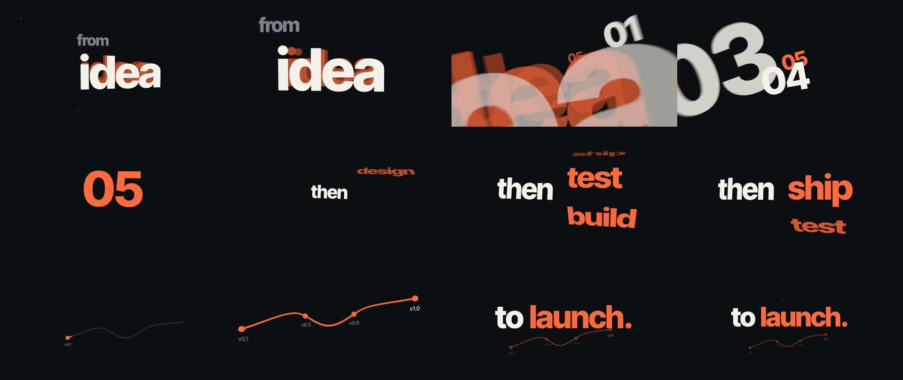

# motion-skills

Skills that teach a coding agent to make motion graphics, with 3D as the first-class case: three.js camera flights, depth, and kinetic type rendered to video.

Most agent-made animation looks the same: fades, slides, linear drifts, a slideshow of stages. These skills give the agent the craft a motion designer carries around:
- named speed-ramp curves;
- continuous camera moves instead of cuts;
- velocity-matched seams;
- one camera writer;
- effects that only appear when the camera moves;
- a working method that leaves taste to the human, through live sliders, while the agent checks facts.

## Skills

| Skill | What it covers | Engine |
|---|---|---|
| [`motion-craft`](skills/motion-craft/SKILL.md) | Motion design for any engine: eight named curves, speed ramps, pacing, camera grammar, seams and transitions, morphs, kinetic type, effects discipline, plus the pitch → variant rounds → live sliders process and render fact-checks | any |
| [`motion-3d`](skills/motion-3d/SKILL.md) | 3D motion graphics with three.js: time → state → one `apply()`, seek-safe state, camera rig and keyed flight paths, depth-pop, pull back through text, tunnels, drums, speed-driven post FX, WebGL rendering. Hosts: Canvas Commons and HyperFrames | three.js |
| [`canvas-commons`](skills/canvas-commons/SKILL.md) | [Canvas Commons](https://github.com/canvas-commons/canvas-commons) / Motion Canvas idiom on 0.4.0: signals, layout, time events, Camera, custom components, glyph gotchas, a live slider panel, and a headless render pipeline (Metal or SwiftShader) | Canvas Commons |

The skills reference each other by name. `motion-3d` and `canvas-commons` both build on `motion-craft`.

## Install

As a Claude Code plugin:

```bash
claude plugin marketplace add Nevoo/motion-skills
claude plugin install motion-skills@motion-skills
```

From a local clone, use `claude plugin marketplace add ./motion-skills` instead.

Or copy the folders under `skills/` into `~/.claude/skills/` (personal) or `.claude/skills/` (per project). Copy all three, since they reference each other.

## Examples

Runnable Canvas Commons projects, each rendered end to end. Every one has a README naming the rules it demonstrates.

| Example | Shows |
|---|---|
| [`motion-3d/examples/cc-flight`](skills/motion-3d/examples/cc-flight/) | One continuous three.js camera flight: depth-pop title, number tunnel, ratcheting word drum, a path drawn through depth, speed-driven lens FX, a 2D lockup over 3D |
| [`motion-3d/examples/cc-card-stack`](skills/motion-3d/examples/cc-card-stack/) | A countdown of stacked gradient pills: the camera punches to each card as it pops in, then pulls back through the headline, which hands off from a 3D plane to 2D type on the same frame |
| [`canvas-commons/examples/explainer-2d`](skills/canvas-commons/examples/explainer-2d/) | A 2D product explainer: typing, pointer click, field-to-pill morph, count-up, column whips, kinetic headline |



## How the skills are organised

Each `SKILL.md` is a short router: cardinal rules, a "when to read what" table, and the assets. The detail lives in:
- `rules/`: one technique per file, indexed in `rules/INDEX.md`;
- `process/`, `hosts/`, `rendering/`, `references/`;
- `assets/`: drop-in code;
- `scripts/` and `templates/` (canvas-commons): the render harness and a starter project.

The agent loads only what the task needs. See [CONTRIBUTING.md](CONTRIBUTING.md) for the file formats and the lint.

## Credits

Some ideas are adapted, in our own words, from [HyperFrames](https://github.com/heygen-com/hyperframes) (Apache-2.0). Details are in [NOTICE.md](NOTICE.md).

## License

MIT. See [LICENSE](LICENSE).
