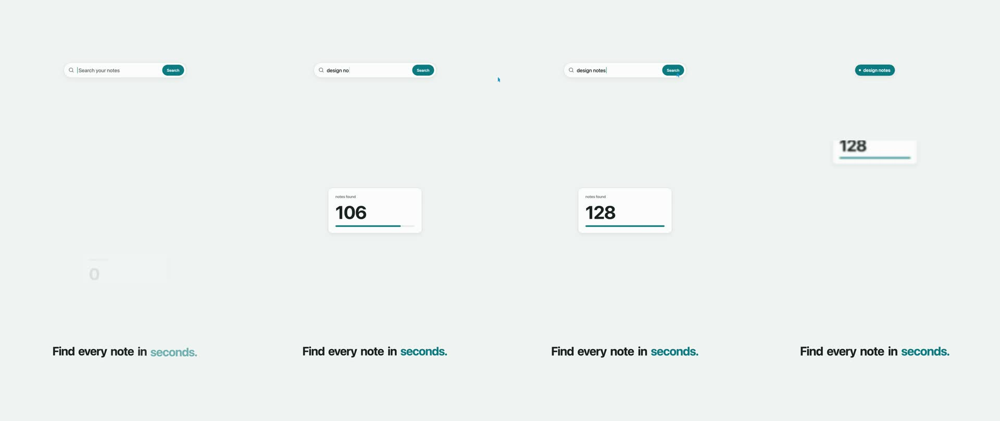

# explainer-2d

A calm 2D product explainer in Canvas Commons, about 8 s at 1920×1080, 60 fps (469 frames). A search field types "design notes", the pointer clicks Search, and the field morphs into a result pill. A camera whip lands on a card counting up to 128, and a hero whip lands on a headline that builds word by word. There is no 3D. Every move is the engine's own `Camera`, signals and time events.



## Rules it demonstrates

| Rule | Where |
|---|---|
| `canvas-commons` → `references/signals.md` | `src/scenes/explainer.tsx:37`: one tween per master signal, everything else binds |
| `motion-craft` → `rules/linear-reads-cheap.md` | `src/scenes/explainer.tsx:45`: typing steps per character instead of a linear reveal |
| `motion-craft` → `rules/curve-pairing.md` | `src/scenes/explainer.tsx:49`, `:217`: morph split by property; pointer x and y on different curves |
| `motion-craft` → `rules/effects-tied-to-motion.md` | `src/scenes/explainer.tsx:62`: blur from the whip's speed, zero at rest |
| `motion-craft` → `rules/one-background.md` | `src/scenes/explainer.tsx:81`: background before the camera, so it never pans |
| `motion-craft` → `rules/column-whip.md`, `canvas-commons` → `references/camera.md` | `src/scenes/explainer.tsx:195`: RAMP glide with a zoom dip |
| `canvas-commons` → `references/time-events.md` | `src/scenes/explainer.tsx:206`: every beat is a draggable `waitUntil` |
| `motion-craft` → `rules/morph-not-crossfade.md` | `src/scenes/explainer.tsx:226`: the morph starts on the release frame |
| `motion-craft` → `rules/kinetic-headlines.md`, `rules/stagger-waves.md` | `src/scenes/explainer.tsx:242`: words build as one wave with one accent |
| `motion-craft` → `rules/reel-pacing.md` | `src/scenes/explainer.tsx:255`: the push-in runs past the end, so the last frame still moves |
| `canvas-commons` → `references/live-panel.md` | `src/params.ts`: plain-language slider labels and the gentle and snappy variants |

## Run it

Needs Node 20.19+ (or 22.12+), system Chrome and `ffmpeg` on the PATH.

```bash
npm install
npm start              # editor at http://localhost:9103, with the live slider panel
npm run smoke          # headless pre-flight: page errors, Render button, WebGL
npm run render         # output/project.mp4 + output/project-sheet.jpg
```
