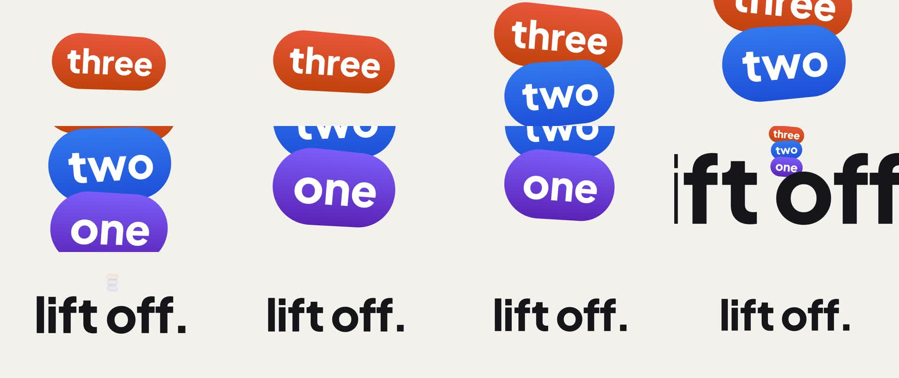

# cc-card-stack

A 3D countdown in Canvas Commons, about 4 s at 1920×1080, 60 fps (246 frames). Three gradient pills (one, two, three) pop in a tilted stack while the camera punches to each one as it lands. Then the camera pulls back through the headline: the stack shrinks, straightens and fades, and "lift off." hands off from a 3D plane to 2D type on the same frame, at the same size.



## Rules it demonstrates

| Rule | Where |
|---|---|
| `motion-3d` → `rules/state-apply-architecture.md` | `src/scenes/card-stack.tsx:76`: signals are the state, one `apply()` writes the scene |
| `motion-3d` → `rules/stacked-gradient-cards.md` | `src/scenes/card-stack.tsx:89` |
| `motion-3d` → `rules/text-as-texture.md` | `src/scenes/card-stack.tsx:105`: baked tight to the ink, so it can match the 2D type |
| `motion-3d` → `rules/frame-by-fill.md` | `src/scenes/card-stack.tsx:118`: every camera distance is a fill fraction |
| `motion-3d` → `rules/playful-tilt.md` | `src/scenes/card-stack.tsx:148`: the turn straightens on the pull-back's curve |
| `motion-3d` → `rules/depth-pop.md` | `src/scenes/card-stack.tsx:153`: cards pop in depth with an unwinding lean |
| `motion-3d` → `rules/pull-back-through-text.md` | `src/scenes/card-stack.tsx:164`: the frustum reveals the headline |
| `motion-3d` → `rules/depth-dissolve.md` | `src/scenes/card-stack.tsx:165`: the headline plane clears only at the lens |
| `motion-3d` → `rules/compositing-3d-and-2d.md` | `src/scenes/card-stack.tsx:183`: 2D under, transparent 3D, 2D over |
| `motion-3d` → `rules/punch-through-stack.md` | `src/scenes/card-stack.tsx:209`: camera and card arrive together |

## Run it

Needs Node 20.19+ (or 22.12+), system Chrome and `ffmpeg` on the PATH.

```bash
npm install            # or once at the repo root, which serves every example
npm start              # editor at http://localhost:9101, with the live slider panel
npm run smoke          # headless pre-flight: page errors, Render button, WebGL
npm run render         # output/project.mp4 + output/project-sheet.jpg
```
